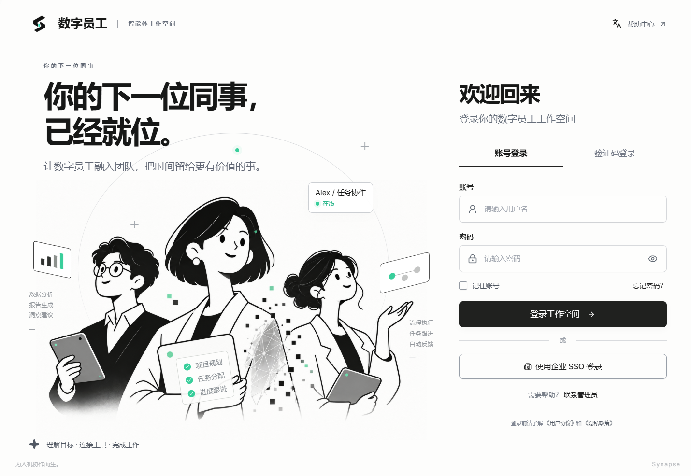
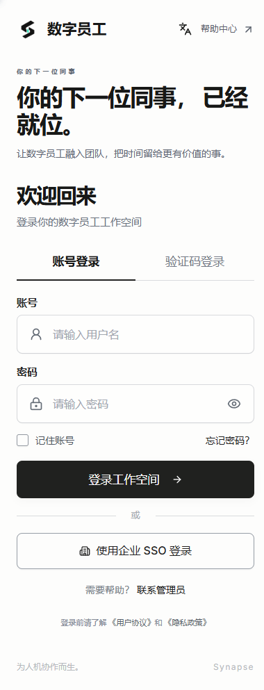

# Synapse

**让数字员工融入团队，把时间留给更有价值的事。**

Synapse 是面向团队的数字员工工作台，将组织管理、协作空间和 AgentScope 智能体能力连接在一个产品中。管理员可以管理租户、成员和权限；团队成员可以在自己的 Workspace 中管理智能体、配置 AI 资源，并通过会话开展工作。

从一个账号开始，按组织划分租户，按团队或项目划分工作空间，让人与智能体在明确的访问边界内协作。



*当前运行版本的真实登录页面，截图于 2026 年 10 月 14 日。*

[核心功能](#核心功能) · [使用流程](#使用流程) · [快速开始](#快速开始) · [当前版本与边界](#当前版本与边界) · [开发与文档](#开发与文档)

## 为什么使用 Synapse

团队引入 AI 后，需要管理的不只是一次对话：还有谁能进入工作空间、谁能修改配置、凭据归谁所有，以及一次任务的过程如何追踪。

Synapse 将这些能力放进同一个工作台：

- **组织与 AI 一起管理**：租户、成员、角色和工作空间与智能体入口使用同一套账号体系。
- **按团队组织工作**：通过 Workspace 切换器进入不同团队或项目的空间，管理对应的成员和资源。
- **让权限可配置**：内置角色覆盖常见分工，自定义角色与菜单授权满足更细的管理需求。
- **让工作过程可见**：会话历史、流式消息、工具事件和人工确认界面帮助查看任务过程。
- **支持自托管**：提供 Docker Compose 部署，数据库、附件和 AI 运行数据通过持久化卷保存。

适合希望搭建内部 AI 工作台的团队、需要区分多个组织或项目的管理者，以及希望在 AgentScope 上扩展业务能力的开发者。

## 核心功能

### 一个工作台，管理多个组织

租户代表公司、组织或客户，Workspace 代表其中的团队或项目空间。同一个账号可以加入多个租户与工作空间，租户成员身份与空间成员身份分别管理。

| 能力 | 可以做什么 |
| --- | --- |
| 租户管理 | 创建与编辑租户，配置有效期开始和结束时间，管理租户状态 |
| 全局用户 | 管理账号、用户状态和平台角色，重置密码 |
| 成员与邀请 | 管理租户成员，通过邀请链接加入租户，并分配角色 |
| Workspace | 创建和管理协作空间，维护成员、空间角色与设置 |
| 空间切换 | 在左上角切换器选择当前工作空间，进入对应业务页面 |

平台管理员、租户 Owner/Admin/Member 与空间 Owner/Admin/Member/Viewer 各自承担不同职责。平台管理员身份不自动赋予读取所有成员私有聊天和凭据的权限。

### 把组织管理规则落到页面与操作

租户内提供角色、菜单、部门、字典和参数管理，用于维护团队的管理结构与应用配置。

| 能力 | 可以做什么 |
| --- | --- |
| 自定义角色 | 创建角色、配置权限，为租户成员分配或撤销角色 |
| 动态菜单 | 管理菜单树、配置角色与菜单的授权关系，按权限展示入口 |
| 部门管理 | 维护部门层级、排序和状态 |
| 字典管理 | 维护字典类型和条目，配置状态与排序 |
| 参数配置 | 管理租户配置项，区分公开投影与敏感值展示 |
| 系统任务 | 配置任务、手动触发、查看执行记录和失败结果 |

页面导航与操作权限由服务端作用域校验共同约束，直接修改 URL 也需要通过租户和空间访问检查。

### 在工作空间中管理数字员工

AgentScope 集成在同一个 Synapse 后端中，前端通过 Workspace 页面访问智能体与会话能力。

- **智能体管理**：创建、查看和编辑智能体定义。
- **会话与聊天**：管理会话、查看历史消息与附件，接收流式文本。
- **过程与人工介入**：展示工具事件，提供生成中断、工具权限确认和外部结果提交界面。
- **模型配置**：管理提供商凭据、自定义模型名称与 Base URL，以及工作空间模型绑定。
- **团队编排**：维护团队与任务定义，创建运行控制记录，查看事件并提交中断请求。
- **扩展资源入口**：知识库、MCP、Skills、SOP、AI 调度和渠道配置已提供前端页面。

模型配置和团队编排当前主要覆盖管理与运行控制记录；扩展页面的可用范围取决于服务配置和外部依赖。真实模型调用、工具执行和完整流程验收的限制见[当前版本与边界](#当前版本与边界)。

### 桌面与手机都可以进入工作台

登录页提供用户名与密码登录、密码显隐、记住账号和中英文切换；管理界面提供侧边栏、面包屑与移动端导航。记住账号仅保存用户名。

<details>
<summary>查看手机登录页</summary>

<p>
  
</p>

</details>

## 使用流程

建议从组织管理开始，再配置工作空间，最后体验 AI 会话。

1. **登录工作台**：首次部署由管理员创建平台账号；团队成员使用已开通的账号登录。
2. **建立组织**：创建租户，配置状态与有效期，添加或邀请成员。
3. **分配职责**：为成员设置租户角色，根据需要配置自定义角色、菜单与部门。
4. **进入团队空间**：创建 Workspace，加入空间成员，分配空间角色，通过切换器进入对应空间。
5. **配置 AI 资源**：查看智能体、模型与凭据页面；真实聊天需要在 AgentScope 凭据入口配置可用模型凭据。
6. **开始会话并查看过程**：选择智能体、创建会话，查看历史与流式消息；按任务需要使用人工确认等交互。

第一次体验建议分别用管理者、普通成员与 Viewer 账号登录，比较菜单、操作按钮和资源可见范围。全新部署不会自动创建演示账号或填充业务数据。

常用入口如下。路径中的租户 ID 和工作空间 ID 应替换为实际数据。

| 场景 | 页面路径 |
| --- | --- |
| 登录 | `/sign-in` |
| 租户与用户 | `/tenants`、`/users` |
| 租户详情 | `/tenants/{tenantId}` |
| 角色与菜单 | `/tenants/{tenantId}/roles`、`/tenants/{tenantId}/menus` |
| 部门、字典、参数 | `/tenants/{tenantId}/departments`、`/tenants/{tenantId}/dictionaries`、`/tenants/{tenantId}/configs` |
| 系统任务与执行记录 | `/tenants/{tenantId}/scheduled-tasks` |
| 空间成员与设置 | `/w/{workspaceId}/members`、`/w/{workspaceId}/settings` |
| 模型与 AgentScope 凭据 | `/w/{workspaceId}/models`、`/w/{workspaceId}/credential` |
| 智能体、团队与会话 | `/w/{workspaceId}/agents`、`/w/{workspaceId}/teams`、`/w/{workspaceId}/sessions`、`/w/{workspaceId}/chat` |
| 知识库、工具与流程 | `/w/{workspaceId}/knowledge`、`/w/{workspaceId}/mcp`、`/w/{workspaceId}/skills`、`/w/{workspaceId}/sop` |
| AI 调度、渠道与附件 | `/w/{workspaceId}/schedule`、`/w/{workspaceId}/channel`、`/w/{workspaceId}/attachments` |

## 快速开始

### Docker Compose 部署

准备 Git、Docker Engine / Docker Desktop 和 Docker Compose，获取源码：

```powershell
git clone https://github.com/RaykieLee/Synapse.git
cd Synapse
```

在仓库根目录创建部署配置：

```powershell
Copy-Item .env.docker.example .env.docker
```

在 `.env.docker` 中设置自己的 `SYNAPSE_JWT_SECRET` 和 `SYNAPSE_AGENTSCOPE_CREDENTIAL_ENCRYPTION_KEY`。两个值都不能保留示例占位符；JWT 密钥建议使用至少 32 字节的随机值，加密密钥必须是有效的 Fernet key，并应在后续重启和升级时保持稳定。可用以下命令生成：

```powershell
python -c "import secrets; print(secrets.token_urlsafe(48))"
python -c "from cryptography.fernet import Fernet; print(Fernet.generate_key().decode())"
```

已有加密凭据时不要直接替换 Fernet key，应先解密并用新 key 重新加密；JWT key 轮换会使现有登录会话失效，用户需要重新登录。

```powershell
docker compose --env-file .env.docker up -d --build
docker compose --env-file .env.docker ps
```

Compose 启动 Web、API、Redis 和 Qdrant 四个服务。API 启动前自动执行数据库迁移，Web 使用 Nginx 提供前端并代理 API。

| 入口 | 默认地址 |
| --- | --- |
| Web | `http://localhost:5173` |
| API 健康检查 | `http://localhost:8010/api/v1/health` |
| Synapse API 文档 | `http://localhost:8010/docs` |
| Redis 本机诊断端口 | `localhost:16382` |
| Qdrant 本机诊断地址 | `http://localhost:16334` |

首次部署创建平台管理员：

```powershell
docker compose --env-file .env.docker exec api python -m app.cli.create_platform_admin
```

按提示设置用户名和至少 12 位密码，再打开 Web 登录。已有数据库保留账号，无需重新初始化。

查看日志与停止服务：

```powershell
docker compose --env-file .env.docker logs -f api
docker compose --env-file .env.docker down
```

数据库、附件、AgentScope 工作目录、Redis 和 Qdrant 数据通过 named volume 持久化。`down` 保留数据，`down -v` 会删除这些数据。原本的本机 SQLite 数据库不会自动导入 Docker。

配置开关、端口及持久化细节见 [Docker 部署说明](docs/docker-deployment.md)。

### 本地开发

前端使用 Node.js 22 与 pnpm 9，后端使用 Python 与 uv。Docker API 镜像采用 Python 3.13，本地 Python 最低版本为 3.11。

在 `apps/api` 中安装依赖并启动：

```powershell
uv sync --frozen --extra dev
Copy-Item .env.example .env
```

根据本机 Redis、Qdrant 和所需功能修改 `.env`，配置 JWT 与凭据加密密钥，然后执行：

```powershell
uv run alembic upgrade head
uv run python -m app.cli.create_platform_admin
uv run uvicorn app.main:create_app --factory --host 127.0.0.1 --port 8010
```

在另一终端进入 `apps/web`：

```powershell
pnpm install --frozen-lockfile
pnpm dev
```

前端默认将 `/api/v1` 代理到 `http://127.0.0.1:8010`；自定义后端地址时，在前端环境文件中设置 `VITE_API_PROXY_TARGET`。

同时运行本地服务与 Docker 栈时，需要调整端口以避免冲突。

## 当前版本与边界

项目仍在持续集成与逐项验收。当前管理功能和 AI 工作台入口已形成可体验版本，页面存在、接口可调用与真实外部执行通过分别记录。

| 模块 | 当前范围与限制 |
| --- | --- |
| 组织与系统管理 | 已实现账号、租户、Workspace、角色、菜单、部门、字典、参数、附件及系统任务；具体增量验收以开发台账为准 |
| 聊天与人工介入 | 已有真实 API/Redis/浏览器验收记录；真实模型推理、工具调用和部分后台恢复仍待实际环境验证 |
| 自定义模型 | 已实现凭据和模型绑定管理；首期提供商为 `openai_chat`，Workspace 模型绑定尚未接入 AgentScope 运行时，不能视为支持任意提供商执行 |
| 团队编排 | 已实现持久化控制记录，当前为 `durable_control_only`；真实团队 worker 和模型执行尚未接入 |
| 知识库 / MCP / Skills / SOP | 已有资源或流程页面及适配代码；完整索引、外部连接、流程执行与隔离终验仍需逐项完成 |
| AI 调度与渠道 | 已有配置页面与可选运行组件；Compose 默认启用调度，关闭 Hub 和渠道，真实外部执行仍需凭据及验收 |
| 登录与个人设置 | 用户名密码、个人资料和修改密码已接入 API；验证码、企业 SSO 和自助找回密码未开放，通知与显示设置仍为演示提交 |
| 人脸识别 | 属于后续迁移计划，尚未完成 |

真实模型、MCP 服务、渠道账号等需要部署者提供对应外部配置。当前 Docker 可启动不代表整个产品已完成全部端到端验收。

功能进度见 [开发与独立验收台账](docs/development-status.md)，验证范围与限制见 [验收报告](docs/verification/)。

## 开发与文档

Synapse 将前后端源码放在同一个仓库中，前端共享路由与导航，后端通过一个 FastAPI 服务承载业务 API 和 AgentScope。

| 层次 | 技术与职责 |
| --- | --- |
| Web | React、TypeScript、Vite、TanStack Router / Query、Tailwind CSS、shadcn/ui |
| API | FastAPI、Pydantic、SQLAlchemy、Alembic |
| AI | AgentScope，依赖锁定到 Git 提交 `42410aff0c007f6fb1687bb749d657108ec48af5` |
| 存储 | 默认 SQLite、Redis、Qdrant 与本地文件持久化 |
| 部署 | 多阶段 Docker 构建、Nginx、Docker Compose |

```text
.
├── apps/
│   ├── web/                 # 产品前端：页面、路由、类型化 API
│   └── api/
│       └── app/
│           ├── api/         # HTTP 接口
│           ├── services/    # 业务规则与用例
│           ├── schemas/     # 请求与响应契约
│           ├── models/      # ORM 模型
│           ├── database/   # 数据库连接与迁移
│           └── integrations/ # AgentScope 认证、作用域与运行适配
├── docs/                    # 方案、契约、验收与产品截图
├── docker-compose.yml
└── CONTEXT.md               # 工程约定
```

API 默认测试在 `apps/api` 中运行，不要求 Redis、浏览器或系统符号链接权限：

```powershell
uv run --extra dev pytest -q
```

外部环境套件按需选择：

```powershell
uv run --extra dev pytest -q -m redis
uv run --extra dev pytest -q -m browser
uv run --extra dev pytest -q -m windows_symlink
uv run --extra dev pytest -q -m integration
```

前端在 `apps/web` 中执行 `pnpm build`、`pnpm lint`；浏览器测试使用 `pnpm test`，需要 Playwright Chromium。

| 想了解什么 | 文档 |
| --- | --- |
| 文档导航 | [文档索引](docs/README.md) |
| 产品范围与实施计划 | [集成计划](docs/integration-plan.md) |
| 实际进度与独立验收 | [开发台账](docs/development-status.md) |
| 账号、租户与空间访问规则 | [认证契约](docs/auth-contract.md)、[租户契约](docs/tenancy-contract.md)、[权限说明](docs/tenancy-authorization-usage.md) |
| 架构与协作约定 | [工程上下文](CONTEXT.md)、[协作约定](AGENTS.md) |
| 部署与持久化 | [Docker 部署](docs/docker-deployment.md) |
| 来源与许可证 | [来源记录](docs/source-provenance.md)、[Web 上游 MIT 许可证](apps/web/LICENSE) |

前端基于 shadcn-admin，组织管理迁移参考 Synapt，AI 能力基于 AgentScope。上游来源和许可证应随相关代码保留，具体来源记录见对应文档。
